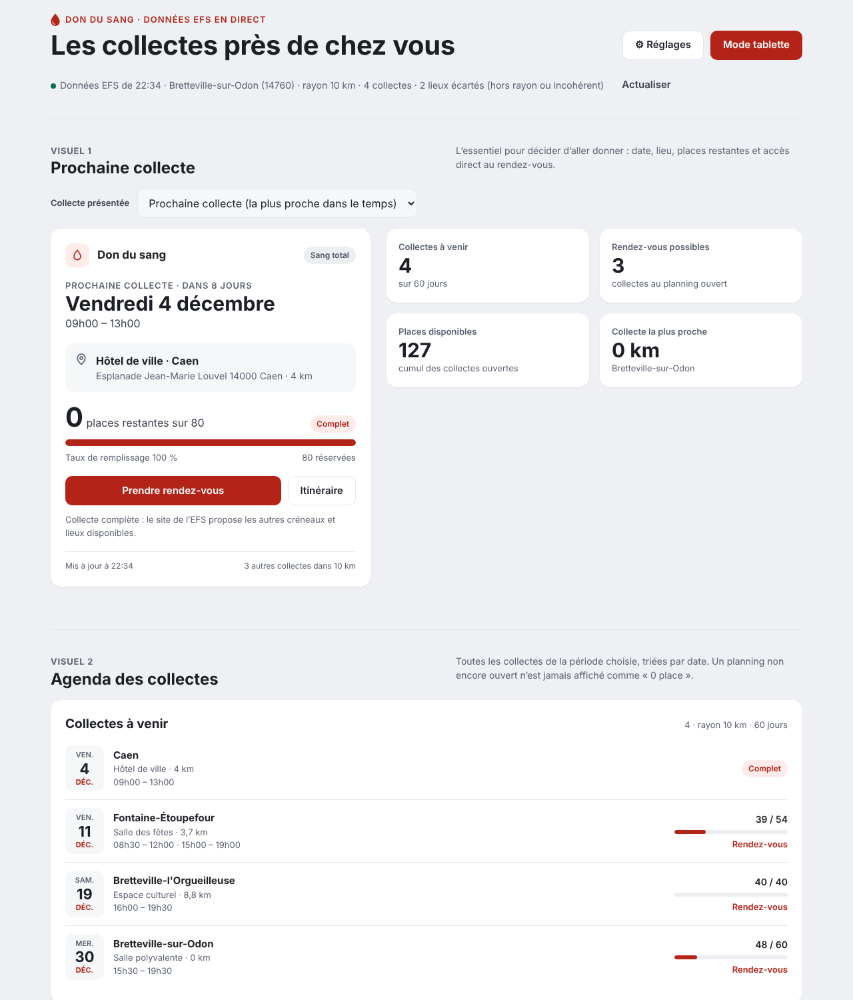
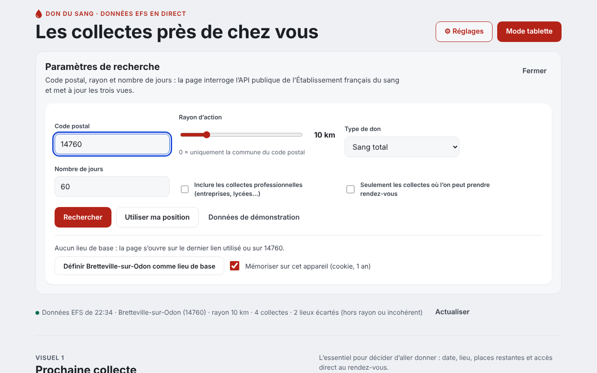
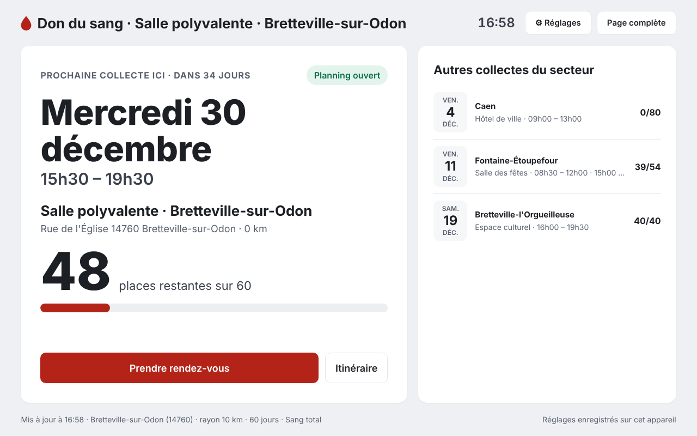
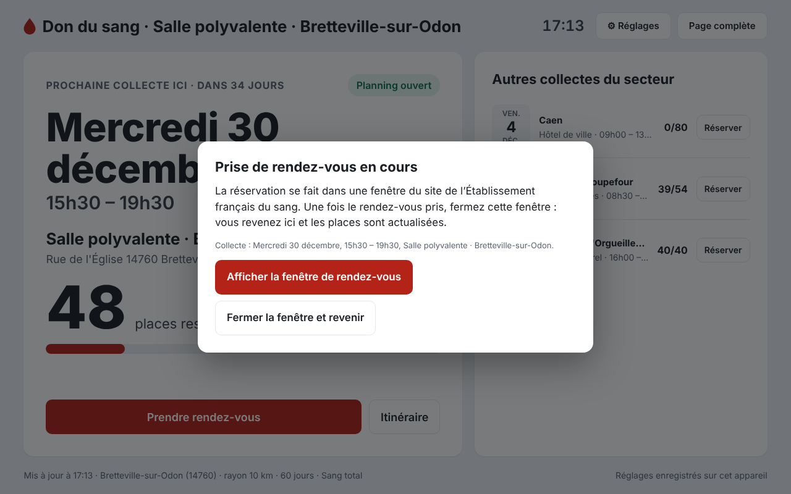
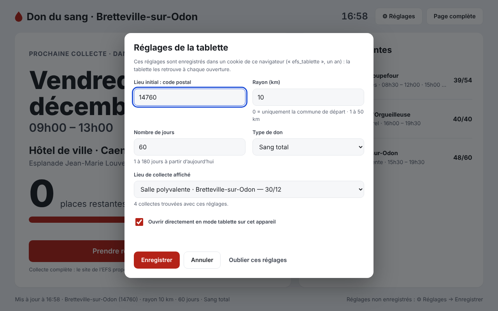
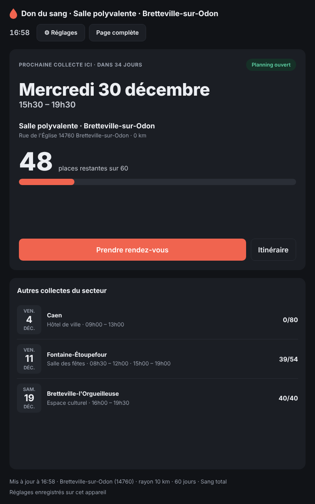

# Collectes de don du sang – page web

Page web autonome qui affiche les prochaines collectes de l’Établissement français du sang autour d’un code postal ou de votre position : prochaine collecte, agenda, carte et remplissage des créneaux. Elle interroge directement les API publiques (API Carto v3 de l’EFS, API Géo de l’État) ; aucune base de données, aucun lien avec Home Assistant.

Version 3.0 · compagnon de l’intégration [HomeAssistant_DonduSang](https://github.com/Laurent14760/HomeAssistant_DonduSang) (mêmes règles : rayon 0 = commune seule, 1 à 180 jours).

## Présentation visuelle

### Page complète

La page présente directement les trois vues : prochaine collecte et indicateurs, agenda, carte et remplissage. En haut, une ligne d’état rappelle le lieu, le rayon et le nombre de collectes.



Le bouton **⚙ Réglages** ouvre la sous-vue des paramètres : code postal, rayon d’action (0 à 50 km), nombre de jours (1 à 180), type de don, options et lieu de base. Elle se referme après la recherche (ou par « Fermer » / Échap).



### Mode tablette

Le bouton **Mode tablette**, en haut à droite à côté de **⚙ Réglages**, bascule la page en affichage lisible de loin pour une tablette murale ou un écran d’accueil ; **Page complète** la ramène à l’affichage normal. On y voit la prochaine collecte du **lieu de collecte choisi** (date, horaires, places restantes, bouton **Prendre rendez-vous**), les autres collectes du secteur, l’heure et la date de mise à jour. Les données se rafraîchissent seules toutes les heures.



**Prendre un rendez-vous avec le donneur en face de soi** : « Prendre rendez-vous » (prochaine collecte) ou « Réserver » (autres collectes) ouvre le site de l’EFS dans une **fenêtre séparée**. La tablette affiche « Prise de rendez-vous en cours » ; une fois le créneau réservé, on ferme cette fenêtre — ou on touche « Fermer la fenêtre et revenir » — et l’on retrouve la tablette, places actualisées.



Le bouton **⚙ Réglages** ouvre une fenêtre simple pour changer le **lieu initial** (code postal, commune), le **rayon**, le **nombre de jours**, le type de don et le **lieu de collecte affiché**. La liste des lieux se met à jour à chaque changement. **Enregistrer** conserve ces réglages dans un cookie de la tablette (`efs_tablette`, un an) : elle rouvre la page directement en mode tablette, sur ce lieu.



En portrait et en thème sombre (suivi automatique du thème de l’appareil) :



## Fonctionnalités

- Recherche par code postal (choix de la commune si plusieurs) ou par géolocalisation, rayon de 0 à 50 km : **0 = uniquement les collectes de la commune du code postal**.
- Nombre de jours de 1 à 180 (défaut 30) ; une valeur hors bornes est signalée, jamais remplacée sans le dire.
- Type de don (sang, plasma, plaquettes), collectes professionnelles, filtre « rendez-vous ouverts ».
- **Mode tablette** : bascule en un clic (« Mode tablette » / « Page complète »), lieu de collecte choisi, réglages par bouton, conservés dans un cookie ; adresse dédiée `?mode=tablette`.
- **Prendre rendez-vous** sur la prochaine collecte : lien direct quand le planning est ouvert, sinon page de réservation du site de l’EFS (planning non ouvert, collecte complète).
- Lieu de base mémorisé à la demande (cookie `efs_lieu_base`) ; recherche conservée dans l’adresse (lien partageable).
- Mode démonstration hors ligne, thème clair et sombre, affichage mobile.

## Déploiement

| Où publier la page | Fichiers à déposer | Relais des API | Guide |
|---|---|---|---|
| Petit hébergement web mutualisé (Apache + PHP : OVH, o2switch, Ionos, Hostinger…) | contenu de `site/` | `site/api/proxy.php` | [MODE_OPERATOIRE.md, option D](MODE_OPERATOIRE.md#option-d--petit-site-web-sur-un-hébergement-mutualisé-apache--php) |
| VPS, NAS ou serveur avec Docker | dépôt complet | nginx (`nginx.conf`) | [option B](MODE_OPERATOIRE.md#option-b--docker-recommandée) |
| Dossier `www` de Home Assistant | contenu de `site/` | aucun | [option A](MODE_OPERATOIRE.md#option-a--héberger-dans-home-assistant-sans-proxy) |

Le relais est nécessaire parce que l’API de l’EFS peut refuser les appels directs d’un navigateur (règle CORS). Démarrage rapide avec Docker :

```bash
git clone https://github.com/Laurent14760/HomeAssistant_DonduSang_Web.git
cd HomeAssistant_DonduSang_Web
docker compose up -d        # puis http://<ip-du-serveur>:8080
```

## Contenu

| Chemin | Rôle |
|---|---|
| `site/` | La page (HTML, CSS, JavaScript sans dépendance) |
| `site/api/proxy.php`, `site/api/.htaccess`, `site/.htaccess` | Relais des API et en-têtes de sécurité pour un hébergement Apache + PHP |
| `nginx.conf`, `docker-compose.yml`, `Dockerfile` | Hébergement Docker et proxy des API |
| `images/` | Captures d’écran de ce document |
| `tests/` | Tests de la logique métier : `node --test tests/efs-core.test.js` |
| `MODE_OPERATOIRE.md` | Installation, mode tablette, exploitation, dépannage |

Page indépendante, non affiliée à l’EFS.
